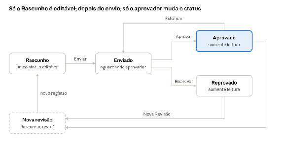

# **Especificação Técnica – Sistema de Orçamentos**

Oct 21, 2026 · @THIAGO

## **1\. Visão geral**

O Sistema de Orçamentos substitui a planilha template.xlsx: o orçamento é montado em dias por fase, convertido em horas por um fator de Horas/Dia, aprovado por um usuário autorizado e guardado como base histórica de consulta.

Objetivo didático: o sistema é a atividade prática de MVC para consultores júnior. Cada etapa introduz um padrão MVC sobre o mesmo sistema real: Modelo 1, pai e filho, pai/filho/neto, várias grids com ocultação, ações customizadas, rotina automática pelo modelo e consulta.

| Item | Definição |
| :---- | :---- |
| Público | Consultores júnior em AdvPL/TLPP |
| Linguagem | TLPP (.tlpp) com namespace, fontes em CP1252 |
| Pré-requisito | Release 12.1.2410 ou superior, que suporta MVC em TLPP |
| Nomenclatura | custom.orc.\<indicativo\>.\<descricao\>.tlpp (seção 7.1) |
| Tabelas | ZB1 a ZB7 |

**Como o dev usa este documento:** a seção 6 diz o que construir em cada etapa e como a entrega será aceita. As seções 2 a 5 são a referência de regras, dados e telas. A seção 7 lista as armadilhas que mais derrubam entregas.

## **2\. Regras de negócio**

As horas são a fonte da verdade: os dias são só uma forma de digitação, e todos os totais somam horas.

### **2.1 Estrutura do orçamento**

* Um **orçamento** (cabeçalho) tem um ou mais **itens da solicitação** (demandas).  
* Cada item tem zero ou mais **atividades**. Para enviar à aprovação, todo item precisa de pelo menos uma.  
* Cada atividade tem quatro fases: **Documentação, Desenvolvimento, Análise e Validação com o cliente**.  
* Cada item é classificado por **Definição** (tipo técnico: Ponto de Entrada, API, Tela, Job...) e por **Área**.

### **2.2 Conversão dias ↔ horas**

| Regra | Descrição |
| :---- | :---- |
| RN01 | O fator **Horas/Dia** pertence a cada orçamento. Na inclusão, inicia com o parâmetro MV\_XHRDIA (padrão 8,50 \= 8h30) e pode ser alterado. Aceita valores maiores que 0 e até 24\. |
| RN02 | Cada fase tem um campo de dias e um de horas, e os dois podem ser editados. Digitou dias: horas \= dias × Horas/Dia (2 decimais). Digitou horas: dias \= horas ÷ Horas/Dia (4 decimais). |
| RN03 | Total da atividade \= soma das quatro fases em horas. Total do item \= soma das atividades. Total do orçamento \= soma dos itens. Linhas excluídas não entram em nenhum total. |
| RN04 | Os totais são somente leitura e se atualizam na hora: ao digitar, ao excluir e ao recuperar linha. |
| RN05 | Se o Horas/Dia mudar e já houver horas lançadas, o sistema pergunta: **Sim** recalcula as horas a partir dos dias; **Não** mantém as horas e recalcula os dias. Em execução sem tela, recalcula as horas. |
| RN06 | Uma atividade só pode ser gravada com total de horas maior que zero. |
| RN07 | As horas também aparecem em hh:mm (ex.: 76,50 \= 76:30), só para exibição. |

### **2.3 Cadastros**

| Regra | Descrição |
| :---- | :---- |
| RN08 | Área e Definição têm código único e flag Ativo. Itens novos só aceitam códigos ativos. |
| RN09 | Não é permitido excluir Área ou Definição já usada em algum item. A orientação é inativar. |
| RN10 | Aprovador \= usuário do Protheus, sem duplicidade. Não pode ser excluído se já tiver histórico de aprovação; nesse caso deve ser inativado. |

### **2.4 Status, revisão e aprovação**

| Regra | Descrição |
| :---- | :---- |
| RN11 | Status possíveis: Rascunho, Enviado, Aprovado e Reprovado. Todo orçamento nasce como Rascunho. |
| RN12 | Só é possível alterar ou excluir em Rascunho. Nos demais status, apenas visualizar. |
| RN13 | Aprovação de **nível único**: qualquer usuário cadastrado e ativo no ZB3 pode aprovar, sem limite de horas. |
| RN14 | **Segregação de função:** quem criou o orçamento não pode aprová-lo, reprová-lo nem estornar a aprovação. |
| RN15 | Reprovar e estornar exigem observação. |
| RN16 | Toda mudança de status grava uma linha no histórico (ZB7) e atualiza o orçamento **na mesma transação**. |
| RN17 | **Nova Revisão** só parte de orçamento Aprovado ou Reprovado: copia tudo para o mesmo número com revisão \+ 1, em Rascunho, sem histórico. A revisão anterior não muda. Só pode haver uma revisão em Rascunho ou Enviado por número. |
| RN18 | **Copiar** gera um orçamento novo (novo número, revisão 01, Rascunho), sem ticket, task e histórico. |

## **3\. Dicionário de dados**

São sete tabelas: três cadastros compartilhados e quatro tabelas de processo exclusivas por filial. Campos marcados como *virtual* não são gravados.

### **3.1 Tabelas (SX2)**

| Tabela | Nome | Papel no MVC | Modo |
| :---- | :---- | :---- | :---- |
| ZB1 | Áreas | Modelo 1 | Compartilhado |
| ZB2 | Definições | Modelo 1 | Compartilhado |
| ZB3 | Aprovadores | Modelo 1 | Compartilhado |
| ZB4 | Orçamento | Pai | Exclusivo |
| ZB5 | Itens do Orçamento | Filho de ZB4 | Exclusivo |
| ZB6 | Atividades do Item | Neto (filho de ZB5) | Exclusivo |
| ZB7 | Histórico de Aprovação | Filho de ZB4, somente leitura | Exclusivo |

### **3.2 ZB1 Áreas e ZB2 Definições (mesma estrutura)**

| Campo | Tipo | Tam | Título | Regra |
| :---- | :---- | :---- | :---- | :---- |
| ZBx\_FILIAL | C | filial | Filial |  |
| ZBx\_COD | C | 3 | Código | Obrigatório, único |
| ZBx\_DESC | C | 40 | Descrição | Obrigatório |
| ZBx\_ATIVO | C | 1 | Ativo | Combo 1=Sim;2=Não, padrão 1 |

Carga inicial sugerida para ZB2: 001 Ponto de Entrada, 002 API REST, 003 Tela MVC, 004 Job/Schedule, 005 Relatório, 006 Integração, 999 Não classificado (usado na importação de planilhas antigas).

### **3.3 ZB3 Aprovadores**

| Campo | Tipo | Tam | Título | Regra |
| :---- | :---- | :---- | :---- | :---- |
| ZB3\_FILIAL | C | filial | Filial |  |
| ZB3\_USER | C | 6 | Usuário | Obrigatório, F3 de usuários, usuário deve existir, único |
| ZB3\_NOME | C | 40 | Nome | Virtual: nome completo do usuário |
| ZB3\_ATIVO | C | 1 | Ativo | Combo 1=Sim;2=Não, padrão 1 |

### **3.4 ZB4 Orçamento**

| Campo | Tipo | Tam | Título | Regra |
| :---- | :---- | :---- | :---- | :---- |
| ZB4\_FILIAL | C | filial | Filial |  |
| ZB4\_COD | C | 6 | Número | Numeração automática (SXE/SXF), não editável |
| ZB4\_REV | C | 2 | Revisão | Padrão 01, não editável |
| ZB4\_TITULO | C | 60 | Título | Obrigatório |
| ZB4\_CLIENT | C | 6 | Cliente | Obrigatório, F3 SA1 |
| ZB4\_LOJA | C | 2 | Loja | Obrigatório, cliente+loja deve existir |
| ZB4\_NOMCLI | C | 40 | Nome Cliente | Virtual, preenchido por gatilho |
| ZB4\_TICKET | C | 20 | Ticket Cliente | Opcional |
| ZB4\_TASK | C | 20 | Atividade Task | Opcional |
| ZB4\_DATA | D | 8 | Data | Obrigatório, padrão data base |
| ZB4\_VALID | D | 8 | Validade | Maior ou igual à Data |
| ZB4\_HRDIA | N | 5,2 | Horas/Dia | Obrigatório, padrão MV\_XHRDIA, entre 0,01 e 24 (RN01, RN05) |
| ZB4\_TOTHR | N | 9,2 | Total Horas | Somente leitura (RN03) |
| ZB4\_STATUS | C | 1 | Status | Combo 1=Rascunho;2=Enviado;3=Aprovado;4=Reprovado, padrão 1, não editável |
| ZB4\_USRINC | C | 6 | Criado por | Padrão usuário logado, não editável |
| ZB4\_USRAPR | C | 6 | Aprovador | Preenchido na aprovação, não editável |
| ZB4\_DTAPR | D | 8 | Data Aprovação | Preenchido na aprovação, não editável |
| ZB4\_HRAPR | C | 8 | Hora Aprovação | Preenchido na aprovação, não editável |
| ZB4\_OBS | M | 10 | Observação | Opcional |

### **3.5 ZB5 Itens do Orçamento**

| Campo | Tipo | Tam | Título | Regra |
| :---- | :---- | :---- | :---- | :---- |
| ZB5\_FILIAL | C | filial | Filial |  |
| ZB5\_COD | C | 6 | Número | Relação com ZB4 (não aparece na tela) |
| ZB5\_REV | C | 2 | Revisão | Relação com ZB4 (não aparece na tela) |
| ZB5\_ITEM | C | 3 | Item | Incremental, único no orçamento |
| ZB5\_DEMAND | C | 80 | Demanda | Obrigatório |
| ZB5\_DEFIN | C | 3 | Definição | Obrigatório, F3 ZB2, só ativos |
| ZB5\_DESDEF | C | 40 | Desc. Definição | Virtual, gatilho |
| ZB5\_AREA | C | 3 | Área | Obrigatório, F3 ZB1, só ativos |
| ZB5\_DESARE | C | 40 | Desc. Área | Virtual, gatilho |
| ZB5\_TOTHR | N | 9,2 | Total Horas | Somente leitura (RN03) |

### **3.6 ZB6 Atividades do Item**

| Campo | Tipo | Tam | Título | Regra |
| :---- | :---- | :---- | :---- | :---- |
| ZB6\_FILIAL | C | filial | Filial |  |
| ZB6\_COD, ZB6\_REV, ZB6\_ITEM | C | 6, 2, 3 |  | Relação com ZB5 (não aparecem na tela) |
| ZB6\_SUB | C | 3 | Sub | Incremental, único no item |
| ZB6\_ATIV | C | 200 | Atividade | Obrigatório |
| ZB6\_DDOC / ZB6\_HDOC | N | 7,4 / 7,2 | Doc. Dias / Doc. Horas | ≥ 0, conversão RN02 |
| ZB6\_DDEV / ZB6\_HDEV | N | 7,4 / 7,2 | Dev. Dias / Dev. Horas | ≥ 0, conversão RN02 |
| ZB6\_DANA / ZB6\_HANA | N | 7,4 / 7,2 | Anál. Dias / Anál. Horas | ≥ 0, conversão RN02 |
| ZB6\_DVAL / ZB6\_HVAL | N | 7,4 / 7,2 | Vald. Dias / Vald. Horas | ≥ 0, conversão RN02 |
| ZB6\_TOTHR | N | 9,2 | Total Horas | Somente leitura, \> 0 para gravar (RN06) |
| ZB6\_TOTHHM | C | 8 | Total hh:mm | Virtual (RN07) |

### **3.7 ZB7 Histórico de Aprovação**

| Campo | Tipo | Tam | Título | Regra |
| :---- | :---- | :---- | :---- | :---- |
| ZB7\_FILIAL | C | filial | Filial |  |
| ZB7\_COD, ZB7\_REV | C | 6, 2 |  | Relação com ZB4 |
| ZB7\_SEQ | C | 3 | Sequência | Sequencial por orçamento/revisão |
| ZB7\_ACAO | C | 1 | Ação | Combo 1=Enviado;2=Aprovado;3=Reprovado;4=Estornado |
| ZB7\_USER | C | 6 | Usuário | Usuário que executou a ação |
| ZB7\_NOMUSR | C | 40 | Nome | Virtual |
| ZB7\_DATA | D | 8 | Data |  |
| ZB7\_HORA | C | 8 | Hora | hh:mm:ss |
| ZB7\_OBS | C | 250 | Observação | Obrigatória em Reprovado e Estornado |

### **3.8 Índices (SIX)**

| Tabela | Ordem | Chave |
| :---- | :---- | :---- |
| ZB1, ZB2 | 1 | FILIAL \+ COD |
| ZB1, ZB2 | 2 | FILIAL \+ DESC |
| ZB3 | 1 | FILIAL \+ USER |
| ZB4 | 1 | FILIAL \+ COD \+ REV |
| ZB4 | 2 | FILIAL \+ CLIENT \+ LOJA \+ COD \+ REV |
| ZB4 | 3 | FILIAL \+ TICKET |
| ZB5 | 1 | FILIAL \+ COD \+ REV \+ ITEM |
| ZB5 | 2 | FILIAL \+ DEFIN |
| ZB6 | 1 | FILIAL \+ COD \+ REV \+ ITEM \+ SUB |
| ZB7 | 1 | FILIAL \+ COD \+ REV \+ SEQ |

### **3.9 Parâmetro (SX6)**

| Parâmetro | Tipo | Conteúdo | Descrição |
| :---- | :---- | :---- | :---- |
| MV\_XHRDIA | N | 8.5 | Horas por dia usadas como padrão em novos orçamentos |

### **3.10 Consultas padrão (SXB)**

Criar F3 para ZB1 (Áreas) e ZB2 (Definições), retornando o código e filtrando apenas registros ativos. Para usuários e clientes, usar as consultas padrão já existentes.

## **4\. Fluxo de status e aprovação**

ciclo de vida do orçamento · 4 status, 5 ações

O orçamento só é editado em Rascunho. Após o envio, apenas um aprovador muda o status, e Aprovado ou Reprovado só voltam a ser editados por meio de uma nova revisão, que é um registro novo.

| Ação | De | Para | Quem pode | Validações | Grava no ZB7 |
| :---- | :---- | :---- | :---- | :---- | :---- |
| Enviar | Rascunho | Enviado | Qualquer usuário com acesso à rotina | Pelo menos 1 item; todo item com pelo menos 1 atividade; total \> 0 | Enviado |
| Aprovar | Enviado | Aprovado | Aprovador ativo (ZB3), exceto o criador | — | Aprovado; preenche aprovador, data e hora no ZB4 |
| Reprovar | Enviado | Reprovado | Aprovador ativo, exceto o criador | Observação obrigatória | Reprovado |
| Estornar | Aprovado | Enviado | Aprovador ativo, exceto o criador | Observação obrigatória; limpa aprovador, data e hora no ZB4 | Estornado |
| Nova Revisão | Aprovado ou Reprovado | Novo registro em Rascunho | Qualquer usuário com acesso à rotina | Não pode existir revisão em Rascunho ou Enviado do mesmo número | Nada (revisão nova nasce sem histórico) |

Em toda ação que muda status: bloquear o registro do ZB4, reler o status depois do bloqueio, gravar ZB4 e ZB7 na mesma transação e liberar o registro. Se o status lido for diferente do esperado, cancelar com mensagem.

## **5\. Telas**

São oito rotinas: três cadastros, o orçamento com suas ações, a importação, a consulta histórica e o relatório. Os esboços mostram disposição e comportamento, não o visual final.

| Código | Arquivo | Tela | Etapa |
| :---- | :---- | :---- | :---- |
| ZORCA01 | custom.orc.cadastro.areas.tlpp | Cadastro de Áreas | 1 |
| ZORCA02 | custom.orc.cadastro.definicoes.tlpp | Cadastro de Definições | 1 |
| ZORCA03 | custom.orc.cadastro.aprovadores.tlpp | Cadastro de Aprovadores | 1 |
| ZORCA04 | custom.orc.orcamento.manutencao.tlpp | Orçamentos (browse e manutenção) | 2, 3 e 4 |
| ZORCA05 | custom.orc.orcamento.aprovacao.tlpp | Ações de aprovação (Enviar, Aprovar/Reprovar, Estornar) | 5 |
| ZORCA06 | custom.orc.orcamento.importacao.tlpp | Importação de planilhas (CSV) | 6 |
| ZORCA07 | custom.orc.consulta.historico.tlpp | Consulta histórica de horas | 7 |
| ZORCR01 | custom.orc.relatorio.orcamento.tlpp | Impressão do orçamento (TReport) | 7 |
| — | custom.orc.util.funcoes.tlpp | Funções comuns (em uso, hh:mm, é aprovador) | 1 |
| — | custom.orc.th | Include com as constantes de status e ações | 1 |

O código curto (ZORCA01...) é usado no restante do documento para facilitar a leitura e também compõe o ID do modelo MVC (ex.: ZORCA01M). O nome do arquivo segue a nomenclatura da seção 7.1.

### **5.1 Cadastros Modelo 1 (ZORCA01, 02 e 03\)**

Browse com legenda (verde \= ativo, vermelho \= inativo) e formulário único. No Aprovador, o nome aparece sozinho ao informar o usuário.

┌ Definições ──────────────────────────────────────────────────┐  
│ \[Incluir\] \[Alterar\] \[Visualizar\] \[Excluir\]                   │  
├──────────────────────────────────────────────────────────────┤  
│   │ Código │ Descrição                          │ Ativo     │  
│ ● │ 001    │ Ponto de Entrada                   │ Sim       │  
│ ● │ 002    │ API REST                           │ Sim       │  
│ ○ │ 005    │ Relatório (descontinuado)          │ Não       │  
└──────────────────────────────────────────────────────────────┘  
   ┌ Definições \- Incluir ─────────────────────────────┐  
   │ Código    \[006\]                                │  
   │ Descrição \[Integração WebService\_\_\_\_\_\_\_\_\_\_\]    │  
   │ Ativo     \[Sim ▼\]                              │  
   │                       \[Confirmar\] \[Fechar\]     │  
   └────────────────────────────────────────────────┘

### **5.2 Browse de Orçamentos (ZORCA04)**

Legenda: branco \= Rascunho, amarelo \= Enviado, verde \= Aprovado, vermelho \= Reprovado. As ações Aprovar/Reprovar e Estornar só aparecem no menu para aprovadores ativos, e a regra também é validada dentro da ação.

┌ Orçamentos ──────────────────────────────────────────────────────────────────┐  
│ \[Incluir\] \[Alterar\] \[Visualizar\] \[Excluir\] \[Copiar\] \[Nova Revisão\]   │  
│ \[Enviar p/ Aprovação\] \[Aprovar/Reprovar\] \[Estornar\] \[Importar\]       │  
│ \[Consulta Histórica\] \[Imprimir\]                                      │  
├────────────────────────────────────────────────────────────────────┤  
│   │ Número │Rev│ Cliente     │ Título                │ Ticket  │ Horas  │  
│ ○ │ 000125 │01 │ CLIENTE A   │ Integração CT-e TMS   │ CHG8812 │  76,50 │  
│ ◐ │ 000124 │02 │ CLIENTE B   │ Ajuste faturamento    │ INC4471 │  25,50 │  
│ ● │ 000123 │01 │ CLIENTE C   │ API de pedidos        │ REQ1002 │ 119,00 │  
└────────────────────────────────────────────────────────────────────┘

### **5.3 Manutenção do Orçamento (ZORCA04)**

Cabeçalho no topo, itens no meio e pastas embaixo. A pasta Atividades mostra só as atividades do item posicionado. O botão **Atividades Similares** abre a consulta histórica (ZORCA07) já filtrada pela Definição do item.

┌ Orçamento \- Alterar ───────────────────────────────────────────────────────────────────────────┐  
│ Número 000125  Rev 01  Status Rascunho      Criado por: analista01       │  
│ Título  \[Integração CT-e com TMS\_\_\_\_\_\_\_\_\_\_\_\_\_\_\_\_\_\_\_\_\_\_\_\_\]              │  
│ Cliente \[000321\] Loja \[01\]  CLIENTE A LTDA                              │  
│ Ticket  \[CHG8812\_\_\_\_\_\]   Task \[TSK-2291\_\_\_\_\_\_\]                          │  
│ Data \[21/10/2026\]  Validade \[20/11/2026\]  Horas/Dia \[8,50\]  Total 76,50 │  
├ Itens da Solicitação ───────────────────────────────────────────────────────────────────────┤  
│ Item │ Demanda                    │ Definição         │ Área │ Tot.Horas      │  
│ ▶001 │ Recepção de CT-e via API   │ 002 API REST      │ TMS  │  59,50         │  
│  002 │ PE na gravação             │ 001 Ponto Entrada │ TMS  │  17,00         │  
├ \[ Atividades \] \[ Histórico de Aprovação \]        \[Atividades Similares\] ┤  
│ Sub│ Atividade         │  Doc     │  Dev     │  Anál    │  Vald    │ Total │  
│    │                   │ Dia│ Hr  │ Dia│ Hr  │ Dia│ Hr  │ Dia│ Hr  │ Horas │  
│ 01 │ Mapear layout     │0,50│ 4,25│0,00│ 0,00│1,00│ 8,50│0,00│ 0,00│ 12,75 │  
│ 02 │ Desenv. endpoint  │0,00│ 0,00│4,00│34,00│0,00│ 0,00│0,50│ 4,25│ 38,25 │  
│ 03 │ Testes unitários  │0,00│ 0,00│0,12│ 1,00│0,00│ 0,00│0,00│ 0,00│  1,00 │  
└──────────────────────────────────────────────────────────────────────────────┘

| Situação | Cabeçalho, Itens, Atividades | Pasta Histórico |
| :---- | :---- | :---- |
| Incluir, Copiar, Nova Revisão | Editáveis | Oculta |
| Alterar (só em Rascunho) | Editáveis | Visível, somente leitura |
| Visualizar (qualquer status) | Somente leitura | Visível, somente leitura |

### **5.4 Aprovar / Reprovar (ZORCA05)**

Tela pequena com os dados do orçamento, a opção Aprovar ou Reprovar e a observação. Estornar usa a mesma tela só com a observação.

┌ Aprovação do Orçamento ─────────────────────────────────────┐  
│ Orçamento 000125 / 01      Cliente CLIENTE A       │  
│ Título Integração CT-e com TMS                     │  
│ Ticket CHG8812   Task TSK-2291                       │  
│ Criado por analista01      Total 76,50 h (76:30)    │  
│ Ação (●) Aprovar  ( ) Reprovar                      │  
│ Observação \[\_\_\_\_\_\_\_\_\_\_\_\_\_\_\_\_\_\_\_\_\_\_\_\_\_\_\_\_\_\_\_\_\]        │  
│ \[Visualizar Orçamento\]       \[Confirmar\] \[Cancelar\] │  
└─────────────────────────────────────────────────────┘

### **5.5 Importação de planilhas (ZORCA06)**

Parâmetros: arquivo CSV, cliente, loja, título, Horas/Dia, ticket, task e Definição padrão (para linhas sem definição). Cada arquivo gera um orçamento em Rascunho. Ao final, um log mostra o orçamento gerado e cada linha rejeitada com o motivo.

Layout do CSV (separador ;, decimal com vírgula). A primeira coluna diz o tipo de linha: I para item e A para atividade do último item lido.

Tipo;Item;Demanda ou Sub;Atividade;Definição;Área;Doc Dias;Dev Dias;Anál Dias;Vald Dias  
I;001;Recepção de CT-e via API;;002;TMS;;;;  
A;001;01;Mapear layout CT-e;;;0,5;0;1;0  
A;001;02;Desenvolver endpoint;;;0;4;0;0,5  
I;002;Ponto de entrada na gravação;;001;TMS;;;;  
A;002;01;Implementar PE;;;0;1,5;0;0,5

### **5.6 Consulta histórica (ZORCA07)**

Filtros: Definição, Área, Cliente, período e "somente aprovados". O resumo mostra, por Definição, a quantidade de itens, média, mínimo e máximo de horas e o percentual de cada fase. O detalhe lista os itens encontrados, com botão para abrir o orçamento.

┌ Consulta Histórica de Horas ─────────────────────────────────────────────────────┐  
│ Definição \[002\] Área \[   \] Cliente \[      \] Período \[..\] a \[..\]  │  
├ Resumo ──────────────────────────────────────────────────────────────────────┤  
│ Definição    │ Itens │ Média │ Mín  │ Máx  │ Doc │ Dev │ Anál│ Vald│  
│ 002 API REST │   14  │ 41,20 │17,00│85,00│  8% │ 62% │ 18% │ 12% │  
├ Detalhe ─────────────────────────────────────────────────────────────────────┤  
│ Orçamento │ Cliente   │ Ticket  │ Demanda                  │ Horas │  
│ 000098/01 │ CLIENTE C │ REQ0871 │ Endpoint de pedidos      │ 42,00 │  
│             \[Abrir Orçamento\] \[Exportar Excel\] \[Fechar\]       │  
└──────────────────────────────────────────────────────────────────┘

### **5.7 Impressão (ZORCR01)**

Relatório TReport do orçamento posicionado: cabeçalho, itens e atividades de cada item, com total por item e total geral em horas e em hh:mm.

## **6\. Etapas do treinamento**

São sete etapas. Cada uma acrescenta um padrão MVC sobre a anterior, e só é aceita quando todos os critérios passam no ambiente de testes.

| Etapa | Entrega | Padrão MVC aprendido |
| :---- | :---- | :---- |
| 1 | Cadastros ZB1, ZB2, ZB3 | Modelo 1 |
| 2 | Orçamento \+ Itens | Pai e filho |
| 3 | \+ Atividades com conversão e totais | Pai, filho e neto |
| 4 | Pastas, histórico e regras por status | Várias grids, ocultação, ações de cópia |
| 5 | Fluxo de aprovação | Ações customizadas e transação |
| 6 | Importação de CSV | Rotina automática pelo modelo |
| 7 | Consulta histórica e relatório | Query e TReport |

### **Etapa 1 – Cadastros em Modelo 1**

**O que fazer:** criar no dicionário as tabelas ZB1, ZB2 e ZB3 (seção 3\) e as rotinas ZORCA01, ZORCA02 e ZORCA03, cada uma com browse, MenuDef, ModelDef e ViewDef.

**Conceitos:** FWMBrowse com legenda, ADD OPTION no MenuDef, FWFormStruct(1/2), MPFormModel, AddFields, SetPrimaryKey, validação de campo, pós-validação do modelo, campo virtual com inicializador e gatilho (ZB3\_NOME).

**Critérios de aceite:**

* ☐ Incluir, alterar, visualizar e excluir funcionam nas três rotinas.  
* ☐ Código de Área/Definição e usuário do Aprovador não aceitam duplicidade.  
* ☐ Aprovador com usuário inexistente é recusado. O nome aparece ao informar o usuário.  
* ☐ Na inclusão do Aprovador, o nome começa vazio, e não com o nome do registro posicionado no browse.  
* ☐ A legenda diferencia ativo e inativo.  
* ☐ Exclusão de código em uso é bloqueada (RN09/RN10). Testar depois que a Etapa 2 existir.  
* ☐ O ID do modelo é diferente do nome do fonte (ex.: ZORCA01M).

### **Etapa 2 – Orçamento e Itens (pai e filho)**

**O que fazer:** criar ZB4 e ZB5 e a rotina ZORCA04 com cabeçalho e grid de itens. Nesta etapa o total de horas do item é digitado manualmente; ele passa a ser calculado na Etapa 3\.

**Conceitos:** AddGrid, SetRelation, SetUniqueLine, AddIncrementField na view, numeração automática (SXE/SXF), inicializadores (data, Horas/Dia, status, usuário), gatilhos de descrição (cliente, definição, área), F3 e validação de cadastro ativo, FWFormStruct com filtro de campos para esconder as chaves de relação na tela.

**Critérios de aceite:**

* ☐ O número é gerado automaticamente e não se perde nem se repete ao cancelar uma inclusão.  
* ☐ O item é incremental (001, 002...) e não se repete no mesmo orçamento.  
* ☐ Definição e Área inativas são recusadas, e as descrições aparecem ao informar o código.  
* ☐ As descrições virtuais aparecem corretas ao reabrir o orçamento, inclusive em linhas novas adicionadas na alteração.  
* ☐ Validade menor que a data é recusada.  
* ☐ Não é possível gravar orçamento sem pelo menos um item.  
* ☐ Excluir o orçamento remove os itens.

### **Etapa 3 – Atividades (pai, filho e neto)**

**O que fazer:** criar ZB6 e acrescentar a grid de atividades como neta do orçamento, com a conversão dias ↔ horas e os totais que sobem para o item e para o cabeçalho (RN01 a RN07).

**Conceitos:** relação de três níveis (o neto se relaciona com o filho), grid que acompanha a linha posicionada do pai, validação de campo que atualiza outros campos com LoadValue, pré-validação de linha (exclusão e recuperação), pós-validação de linha, FWSaveRows/FWRestRows ao percorrer grids, SetOptional.

**Critérios de aceite:**

* ☐ Digitar 1,5 dia com Horas/Dia 8,50 gera 12,75 horas. Digitar 1 hora gera 0,1176 dia.  
* ☐ O valor digitado pelo usuário nunca é alterado pelo recálculo do campo correspondente (sem ida e volta).  
* ☐ Os totais da atividade, do item e do cabeçalho se atualizam ao digitar, ao excluir e ao recuperar linhas de atividade e de item.  
* ☐ Trocar o Horas/Dia com horas lançadas faz a pergunta da RN05 e as duas respostas funcionam.  
* ☐ Atividade com total zero não é gravada.  
* ☐ Ao trocar de item, a grid mostra só as atividades daquele item.  
* ☐ Excluir um item remove as atividades dele.  
* ☐ Os totais gravados no banco batem com a soma das linhas, mesmo que algo falhe na tela (recálculo na pós-validação do modelo).

### **Etapa 4 – Pastas, histórico e regras por status**

**O que fazer:** organizar a parte inferior da tela em pastas (Atividades e Histórico de Aprovação), criar a ZB7 como grid somente leitura, aplicar as regras de edição por status e criar as ações Copiar e Nova Revisão (RN12, RN17, RN18). Incluir o botão Atividades Similares, que só será funcional na Etapa 7\.

**Conceitos:** CreateFolder, AddSheet, boxes dentro de pastas, SetOnlyQuery, SetNoInsertLine/SetNoUpdateLine/SetNoDeleteLine, SetVldActivate, SetActivate, operação de cópia (IsCopy), FWExecView, AddUserButton, ações na view após a ativação.

**Critérios de aceite:**

* ☐ Alterar ou excluir orçamento fora de Rascunho mostra mensagem e não abre a tela.  
* ☐ A pasta Histórico fica oculta na inclusão, cópia e nova revisão, e não permite inserir, alterar ou excluir linhas.  
* ☐ Copiar gera novo número, revisão 01, Rascunho, sem ticket, task e dados de aprovação.  
* ☐ Nova Revisão mantém o número, soma 1 na revisão e só é permitida a partir de Aprovado ou Reprovado.  
* ☐ Nova Revisão é recusada se já existir revisão em Rascunho ou Enviado para o mesmo número.  
* ☐ O histórico nunca é copiado.

### **Etapa 5 – Fluxo de aprovação**

**O que fazer:** criar a rotina ZORCA05 com as ações Enviar, Aprovar/Reprovar e Estornar (seção 4\) e ligá-las ao menu do ZORCA04.

**Conceitos:** ação customizada no MenuDef, menu condicionado ao perfil do usuário, RetCodUsr(), Begin Transaction/End Transaction, bloqueio e releitura do registro antes de alterar o status, tela simples de diálogo.

**Critérios de aceite:**

* ☐ Enviar só funciona em Rascunho, com todos os itens tendo pelo menos uma atividade e total maior que zero.  
* ☐ Aprovar, Reprovar e Estornar não aparecem no menu para quem não é aprovador ativo, e são recusados mesmo se chamados por outro caminho.  
* ☐ O criador do orçamento é recusado como aprovador (RN14).  
* ☐ Reprovar e Estornar sem observação são recusados.  
* ☐ Cada ação grava uma linha no ZB7 com sequência, usuário, data, hora e observação.  
* ☐ Se a gravação do histórico falhar, o status não muda (mesma transação).  
* ☐ Dois usuários aprovando ao mesmo tempo: só um consegue, o outro recebe mensagem de status alterado.

### **Etapa 6 – Importação de planilhas (rotina automática pelo modelo)**

**O que fazer:** criar a rotina ZORCA06, que lê o CSV da seção 5.5 e grava o orçamento usando o próprio modelo do ZORCA04, sem tela.

**Conceitos:** FWLoadModel, SetOperation, Activate, SetValue em campos e grids, AddLine, VldData, CommitData, GetErrorMessage, DeActivate, leitura de arquivo, parâmetros com ParamBox, barra de progresso.

**Critérios de aceite:**

* ☐ Um CSV válido gera um orçamento em Rascunho com os mesmos totais que a planilha original.  
* ☐ Todas as regras das Etapas 2 e 3 valem na importação, sem nenhuma validação duplicada no fonte de importação.  
* ☐ Linha sem Definição usa a Definição padrão informada.  
* ☐ Linhas inválidas aparecem no log com número da linha e motivo.  
* ☐ Nenhuma pergunta ou mensagem de tela aparece durante a gravação.

### **Etapa 7 – Consulta histórica e relatório**

**O que fazer:** criar a consulta ZORCA07 (seção 5.6), ligar o botão Atividades Similares do ZORCA04 a ela, e criar o relatório ZORCR01 (seção 5.7).

**Conceitos:** query com filtro de filial e D\_E\_L\_E\_T\_, parâmetros com valores tratados contra SQL injection, browse sobre array, agregação (média, mínimo, máximo e percentuais), TReport com seções.

**Critérios de aceite:**

* ☐ Os filtros funcionam isolados e combinados, e a consulta considera só a filial corrente e registros não excluídos.  
* ☐ O resumo bate com um cálculo manual feito em planilha sobre os mesmos dados.  
* ☐ O botão Atividades Similares abre a consulta filtrada pela Definição do item posicionado.  
* ☐ Abrir Orçamento mostra o orçamento em modo visualização.  
* ☐ O relatório imprime cabeçalho, itens, atividades e totais em horas e hh:mm.

## **7\. Orientações técnicas e armadilhas**

A regra que vale para todas as etapas: **toda regra de negócio fica no modelo, nunca na view.** A Etapa 6 grava sem tela e só vai respeitar as regras que estiverem no modelo.

### **7.1 Padrões obrigatórios**

| Tema | Orientação |
| :---- | :---- |
| Nome do arquivo | custom.\<siglamodulo\>.\<indicativo\>.\<descricao\>.tlpp, tudo em minúsculas. custom é fixo; a sigla do módulo deste sistema é orc; o indicativo é o processo (cadastro, orcamento, consulta, relatorio, util); a descrição é a proposta do fonte. Ex.: custom.orc.cadastro.areas.tlpp. |
| Namespace | Igual ao nome do arquivo sem a extensão (ex.: namespace custom.orc.cadastro.areas). Assim cada fonte tem o próprio namespace e as funções MVC (ModelDef, ViewDef, MenuDef) nunca colidem entre fontes. |
| Funções MVC em TLPP | MenuDef, ModelDef e ViewDef deixam de ser user Function e passam a ser User Function dentro do namespace. Em FWLoadModel, FWLoadView e no ACTION "VIEWDEF.\<...\>" do menu, informar o namespace completo mais o nome da função principal ([TDN](https://tdn.totvs.com/display/framework/Suporte+a+TLPP+no+Protheus)). |
| Função principal | main em todos os fontes (ex.: custom.orc.cadastro.areas.main), que é o que vai no menu do SIGACFG. |
| ID do modelo | Código curto \+ M (ex.: ZORCA01M), diferente do nome da função principal, porque ele também vira o nome do ponto de entrada MVC. IDs de submodelo no padrão ZB4MASTER, ZB5DETAIL. |
| Endpoints REST | Se o sistema expuser API no futuro: /api/\<siglamodulo\>/\<indicativo\>/\<descricao\>, ex.: /api/orc/consulta/historico. O fonte do endpoint segue a mesma regra de arquivo. |
| Encoding | Fontes em CP1252 (Windows-1252). Arquivo em UTF-8 compila com acentuação quebrada. |
| Mensagens | Help() com problema e solução. Nada de MsgAlert/MsgYesNo dentro de validação que roda em transação ou sem tela (use IsBlind()). |
| Constantes | Status e ações em \#Define no include custom.orc.th, nunca "1", "2" soltos no código. |
| Queries | Sempre filtrar filial (xFilial) e D\_E\_L\_E\_T\_ \= ' '. Valores do usuário por parâmetro (FWPreparedStatement ou %exp:%), nunca concatenados. Fechar o alias ao terminar. |
| Área de trabalho | GetArea/RestArea em toda função que posiciona tabelas. |
| Tipagem | Declarar o tipo de variáveis, parâmetros e retornos (as character, as numeric, as object...). |
| Documentação | Cabeçalho Protheus.doc em toda função. |

### **7.2 Armadilhas que mais derrubam entregas**

1. **Ida e volta entre dias e horas.** Se a validação de Dias usar SetValue em Horas e a de Horas usar SetValue em Dias, uma dispara a outra e o arredondamento altera o valor que o usuário digitou (0,33 dia vira 0,3306). O campo do outro lado deve ser preenchido com LoadValue, que não dispara validação nem gatilho.  
2. **Valor novo ainda não gravado.** Dentro da validação do campo, GetValue daquele campo ainda devolve o valor antigo. Para calcular o total, use o valor recebido como parâmetro da validação.  
3. **Linha excluída entrando no total.** Ao somar uma grid, ignore as linhas com IsDeleted(). Na pré-validação de exclusão, a linha ainda não está marcada: trate a ação DELETE/UNDELETE explicitamente.  
4. **Mudar a linha posicionada no meio de uma validação.** GoLine dentro da validação de um campo muda a linha que o usuário está editando. Para ler outras linhas, use GetValue(campo, nLinha). Para percorrer grids (recálculo do Horas/Dia, pós-validação), salve e restaure as posições com FWSaveRows/FWRestRows.  
5. **Inicializador de campo virtual na inclusão.** Na inclusão, a tabela continua posicionada no registro do browse. Um inicializador como Posicione(..., ZB3-\>ZB3\_USER, ...) mostra o nome de outro registro. Verifique a operação antes de usar o alias.  
6. **Descrição virtual em linha nova da grid.** O mesmo problema acontece em linhas adicionadas na alteração. Teste sempre: abrir um orçamento existente, adicionar uma linha e conferir se as descrições começam vazias.  
7. **Status alterado por RecLock solto.** A mudança de status (Etapa 5\) precisa de transação, bloqueio do registro e releitura do status depois do bloqueio, porque outro usuário pode ter aprovado no meio tempo.  
8. **Esconder botão não é controle de acesso.** Validar o aprovador no menu e também dentro da ação.  
9. **Validação duplicada na importação.** Se o ZORCA06 precisar repetir alguma regra para funcionar, a regra está no lugar errado: ela deve ir para o modelo do ZORCA04.  
10. **Histórico sendo copiado.** Na cópia e na nova revisão, o MVC copia todas as grids. A grid do histórico deve ser somente consulta (SetOnlyQuery) para não ser gravada no registro novo.

### **7.3 Pontos para confirmar na release do ambiente**

Alguns recursos variam conforme a versão da lib. Se não funcionarem, o dev deve registrar e buscar alternativa com o instrutor:

* Ocultar uma pasta da view em tempo de execução (Histórico na inclusão).  
* Comportamento dos inicializadores na operação de cópia (numeração SXE pode ser reservada duas vezes).  
* LoadValue fora de uma validação de campo (pré-validação de linha, ativação do modelo).  
* O nome exato da função MVC em TLPP no menu do SIGACFG, no VIEWDEF e no FWLoadModel. Validar com o primeiro cadastro da Etapa 1 antes de seguir para os demais.

### **7.4 Referências**

* [FWFormGridModel](https://tdn.totvs.com/display/framework/FWFormGridModel) (TDN): LoadValue, SetUniqueLine, SetOnlyView, AddLine.  
* [FwStruTrigger](https://tdn.totvs.com/display/framework/FwStruTrigger) (TDN): gatilhos criados no fonte.  
* [FWFormView](https://tdn.totvs.com/display/framework/FWFormView) (TDN).  
* [FormLoadGrid](https://tdn.totvs.com/display/framework/FormLoadGrid) (TDN): carga de grid.

## **8\. Entregáveis, avaliação e cronograma**

Cada etapa é entregue completa, com fonte, dicionário e evidência de teste, e só é aceita com todos os critérios da seção 6 marcados.

### **8.1 Entregáveis por etapa**

| Entregável | Conteúdo |
| :---- | :---- |
| Fontes | .tlpp em CP1252, com namespace e nome conforme a seção 7.1, compilando sem warnings |
| Dicionário | Tabelas, campos, índices, consultas e parâmetro criados na base de testes, com print ou exportação |
| Roteiro de teste | Pelo menos 3 casos positivos e 3 negativos por etapa, com resultado esperado e obtido |
| Evidências | Prints ou vídeo curto dos critérios de aceite |
| Autoavaliação | O que ficou difícil e o que o dev faria diferente |

### **8.2 Como a entrega é avaliada**

| Critério | Peso |
| :---- | :---- |
| Critérios de aceite da etapa atendidos | 50% |
| Regras no modelo, sem duplicação na view ou na importação | 20% |
| Padrões da seção 7.1 (nomes, mensagens, queries, documentação) | 15% |
| Roteiro e evidências de teste | 15% |

A revisão de código é feita em par com o instrutor ao fim de cada etapa. Pendências voltam como correção antes de liberar a etapa seguinte.

### **8.3 Cronograma sugerido**

| Semana | Etapas |
| :---- | :---- |
| 1 | Etapa 1 |
| 2 | Etapa 2 |
| 3 e 4 | Etapa 3 (a mais difícil) |
| 5 | Etapa 4 |
| 6 | Etapa 5 |
| 7 | Etapa 6 |
| 8 | Etapa 7 e revisão final |
